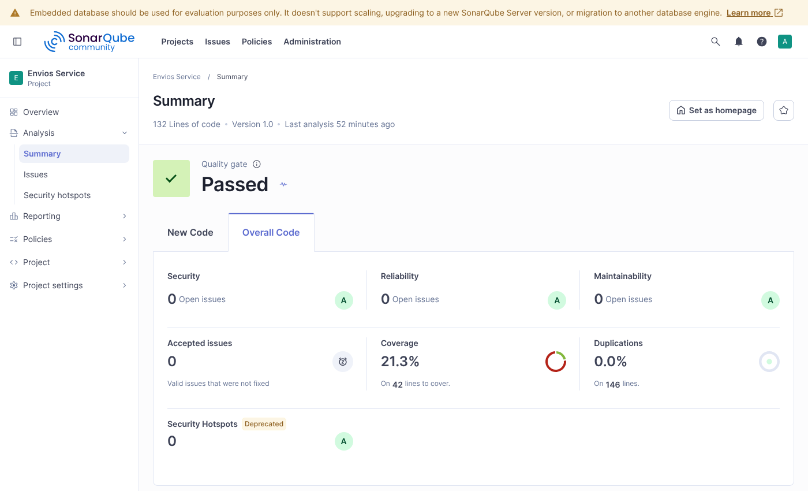
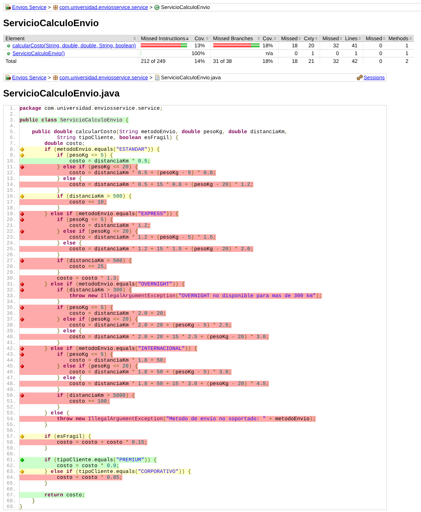
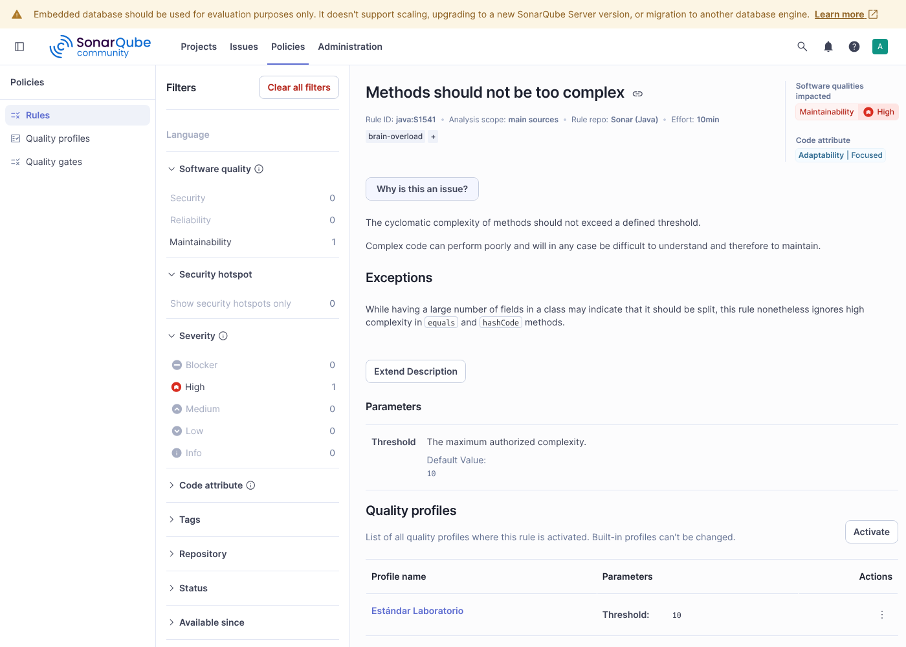
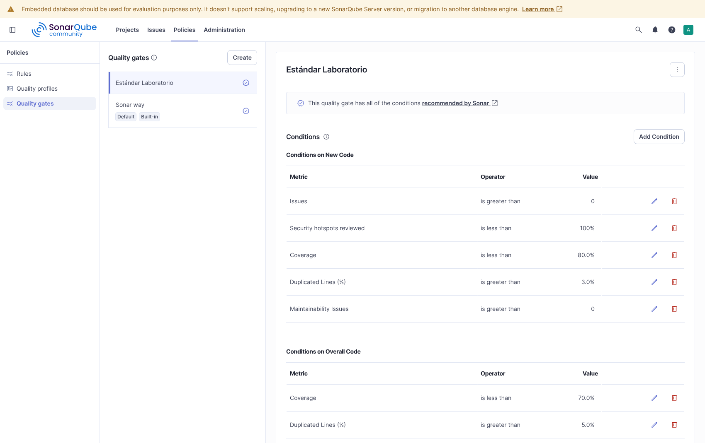
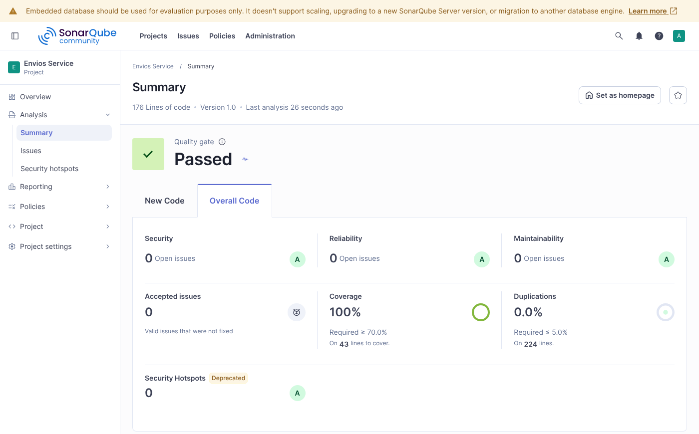
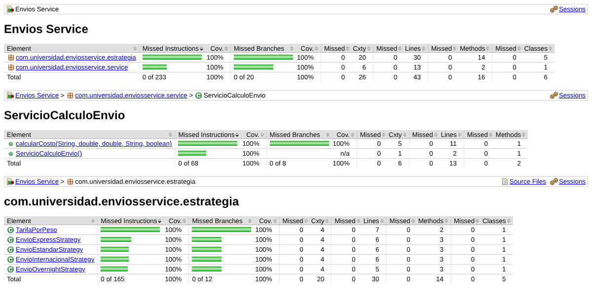

# Envios Service — Diagnóstico y Mejora Guiada por Métricas

## Descripción
Repositorio del post-contenido de la Unidad 10 de Patrones de Diseño de Software. Proyecto Maven plano (`envios-service`, sin Spring Boot) cuya clase `ServicioCalculoEnvio` calcula el costo de un envío según el método de transporte, el peso, la distancia, la fragilidad y el tipo de cliente. En la Parte 1 se analizó el código tal como se entregó, con SonarQube y JaCoCo, para ubicar con datos dónde estaba el problema. En la Parte 2 se refactorizó con el patrón Strategy, se agregaron pruebas sobre las ramas que estaban sin cubrir, se configuró el Quality Profile y el Quality Gate "Estándar Laboratorio" y se repitió el análisis para comparar.

## Estructura final
```
src/main/java/com/universidad/enviosservice/
├── service/
│   └── ServicioCalculoEnvio.java        orquestador: elige la estrategia y aplica fragilidad y tipo de cliente
└── estrategia/
    ├── EstrategiaEnvio.java             interfaz común
    ├── TarifaPorPeso.java               cálculo por tramos de peso, compartido
    ├── EnvioEstandarStrategy.java
    ├── EnvioExpressStrategy.java
    ├── EnvioOvernightStrategy.java
    └── EnvioInternacionalStrategy.java
src/test/java/com/universidad/enviosservice/
├── service/ServicioCalculoEnvioTest.java       7 pruebas (las 2 originales sin cambios)
└── estrategia/                                  19 casos, uno o más por estrategia
```

## Estado inicial del análisis (Parte 1)
Valores reales del primer análisis (commit `test: agregar suite inicial de ServicioCalculoEnvioTest y configurar SonarQube`), con el perfil por defecto de Java:

| Métrica | Valor real observado |
|---------|----------------------|
| Complejidad ciclomática de calcularCosto() | 20 |
| Complejidad cognitiva de calcularCosto() | 32 |
| Cobertura de líneas de ServicioCalculoEnvio | 23,8 % (10 de 42 líneas) |
| Cobertura de ramas de ServicioCalculoEnvio | 18,4 % (7 de 38 condiciones) |
| Code Smells reportados | 0 |
| Duplicación | 0,0 % |
| Pruebas | 2 |

### Interpretación
**Qué método concentra el problema.** `calcularCosto()` es el único método de la clase, así que la complejidad del archivo (20) es la del método. El valor coincide con el conteo manual de la guía: 1 camino base + 4 por la cadena de métodos de envío + 12 por los tramos de peso y los recargos o límites de distancia de cada rama + 1 por la fragilidad + 2 por el tipo de cliente. Según la Tabla 3.2 de la guía, 20 está en el rango "Alta".

**Qué ramas quedaron sin cubrir.** Las dos pruebas de partida usan el mismo envío (`ESTANDAR`, 3 kg, 100 km, no frágil) y solo cambian el tipo de cliente. En el reporte de JaCoCo las únicas ramas en verde eran: la condición `ESTANDAR` en verdadero, `pesoKg <= 5` en verdadero, `distanciaKm > 500` en falso, `esFragil` en falso, `PREMIUM` en verdadero y en falso, y `CORPORATIVO` en falso. Todo lo demás estaba en rojo.

**Por qué coinciden la complejidad y la falta de cobertura.** Son la misma causa vista desde dos lados: 20 caminos independientes exigen al menos 20 casos para cubrir todas las ramas, y la suite tenía 2. Cada condicional que se agregaba al método subía la complejidad y, sin la prueba correspondiente, bajaba la cobertura de ramas.

**Hallazgo: el perfil por defecto no reportó nada.** El primer análisis terminó con 0 Code Smells y el Quality Gate por defecto en verde. En esta versión de SonarQube (Community Build 26.11) el perfil por defecto de Java se llama "Sonar way core" y no trae activas ni la regla de complejidad cognitiva (S3776) ni la de complejidad ciclomática por método (S1541). La guía indica que Sonar way marca por defecto los métodos con CC > 10; en esta versión eso ya no ocurre sin configurarlo. Las métricas existen en la pestaña Measures, pero no se convierten en hallazgos.

## Decisiones de diseño

### 1. Entorno de análisis: SonarQube local
Se eligió una instancia local de SonarQube Community Build 26.11 (la distribución descargable, iniciada con `sonar.sh start`) en lugar de SonarCloud, por dos criterios de la tabla del enunciado:

- **Control total de la configuración.** La Parte 2 exige duplicar el perfil de calidad de Java, activar una regla con un umbral propio y crear un Quality Gate con condiciones específicas. En la instancia local todo eso se hace con la cuenta de administrador, sin depender de lo que permita el plan gratuito de un servicio externo.
- **Sin depender de conectividad ni de la visibilidad del proyecto.** El análisis se ejecuta contra `localhost:9000` y los resultados no quedan publicados; en SonarCloud un proyecto gratuito es público.

El costo aceptado es el que indica la misma tabla: el servidor consume memoria de la máquina (levanta Elasticsearch, el servidor web y el motor de cómputo) y tuvo que estar encendido durante todo el laboratorio, incluido el segundo análisis. Con Docker (`sonarqube:community`) el costo sería el mismo; se usó la distribución directa porque no hacía falta nada más que Java.

### 2. Exclusiones del análisis: ninguna
`sonar.exclusions` quedó comentado en `sonar-project.properties`. El proyecto no tiene clase de arranque, ni código generado, ni DTOs: todo `src/main/java` es lógica de negocio y es justamente lo que se quería medir. Excluir algo solo tendría sentido si una clase sin lógica bajara el porcentaje de cobertura sin decir nada sobre la calidad del código. Las pruebas no necesitan exclusión porque `sonar.tests` ya las separa del código analizado.

Un detalle de configuración: `mvn sonar:sonar` no lee `sonar-project.properties` (ese archivo lo usa el SonarScanner de línea de comandos). Por eso las propiedades `sonar.*` también están en el `pom.xml`, que es de donde las toma el scanner de Maven.

### 3. Métrica usada como señal principal: complejidad cognitiva
Las tres señales apuntaban al mismo método: complejidad ciclomática 20, complejidad cognitiva 32 y cobertura de ramas 18,4 %. Se tomó la **complejidad cognitiva** como señal principal para decidir qué intervenir, y las otras dos con un papel definido:

- **Cognitiva (señal principal).** Mide lo que cuesta leer y modificar el método: penaliza el anidamiento, y en `calcularCosto()` cada tramo de peso estaba anidado dentro de una rama de método de envío. Su valor (32) era más del doble del umbral que usa SonarQube para esa regla (15). El problema a resolver era de mantenimiento, no solo de cantidad de caminos.
- **Ciclomática (dimensionar las pruebas y medir la reducción).** Indica cuántos casos hacen falta como mínimo para cubrir todas las ramas y es la meta de reducción que pide el laboratorio (al menos 50 %).
- **Cobertura de ramas (medir el riesgo).** Confirmó que el método más complejo era además el menos probado, que es la peor combinación para modificarlo.

### 4. Patrón elegido: Strategy
Antes de escribir código se respondieron las tres preguntas del Paso 7 sobre `calcularCosto()`:

- **¿Guarda estado entre llamadas?** No. La clase no tiene atributos que cambien; el resultado depende solo de los cinco parámetros. Eso descarta **State**, que tiene sentido cuando el objeto recuerda en qué estado quedó y ese estado limita lo que puede pasar después.
- **¿Hay una secuencia de responsables donde el orden importa y más de uno podría aplicar?** No. Para un envío aplica exactamente una rama, elegida una sola vez por `metodoEnvio`; ninguna rama "pasa" la solicitud a otra. Eso descarta **Chain of Responsibility**.
- **¿Cada rama calcula el mismo tipo de resultado con una fórmula propia?** Sí: las cuatro calculan un costo, cada una con sus tarifas y su regla particular (recargo por distancia en ESTANDAR, EXPRESS e INTERNACIONAL, factor 1,3 en EXPRESS, límite de 300 km en OVERNIGHT). Es la señal de **Strategy**.

**Qué se movió y qué se quedó.**
- A cada estrategia se movió lo que es propio de su método de envío: sus tarifas, su recargo o su límite.
- A `TarifaPorPeso` se movió el cálculo por tramos de peso. Al separar las cuatro ramas apareció que las cuatro repetían la misma estructura (hasta 5 kg, de 5 a 20 kg, más de 20 kg) con números distintos. Copiar esa estructura en cuatro clases habría dejado duplicación evitable; con un `record` que recibe las tarifas, cada estrategia declara sus valores (`new TarifaPorPeso(0.5, 0, 0.8, 1.2)`) y el cálculo existe una sola vez.
- En el orquestador se quedaron la fragilidad y el tipo de cliente, porque aplican igual a los cuatro métodos. Meterlos en cada estrategia los repetiría cuatro veces. Tampoco se aplicó Strategy al tipo de cliente: son dos descuentos fijos y un `if/else` es más claro que dos clases nuevas.

Por eso `calcularCosto()` no baja a CC = 1: queda en 5 (1 + estrategia nula + fragilidad + los dos tipos de cliente), dentro del rango "Moderada" de la Tabla 3.2.

**Verificación del comportamiento.** Antes de agregar pruebas se comparó la versión original con la refactorizada sobre 4.290 combinaciones de método, peso, distancia, tipo de cliente y fragilidad, incluidos los valores límite (5 y 20 kg; 300, 500 y 5.000 km) y los casos que lanzan excepción. Los resultados fueron idénticos en todas. Las dos pruebas originales siguen pasando sin cambios.

### 5. Criterio de pruebas agregadas
Cada prueba nueva corresponde a una rama que el reporte de JaCoCo de la Parte 1 mostraba en rojo; las que verifican límites usan el valor exacto del borde y no un valor cualquiera del tramo:

| Rama sin cubrir en la Parte 1 | Prueba que la cubre |
|-------------------------------|---------------------|
| ESTANDAR, tramo de 5 a 20 kg y más de 20 kg | `EnvioEstandarStrategyTest` con 5, 20 y 25 kg |
| ESTANDAR, recargo por más de 500 km | `EnvioEstandarStrategyTest` con 500 km (sin recargo) y 501 km (con recargo) |
| Rama EXPRESS completa (tres tramos, recargo y factor 1,3) | `EnvioExpressStrategyTest`, incluido el caso que confirma que el recargo también se multiplica por 1,3 |
| Rama OVERNIGHT completa y su excepción | `EnvioOvernightStrategyTest`: tres tramos, 300 km exactos (permitido) y 301 km (excepción con su mensaje) |
| Rama INTERNACIONAL completa y recargo por más de 5.000 km | `EnvioInternacionalStrategyTest`: tres tramos, 5.000 km exactos y 6.000 km |
| `esFragil` en verdadero | `calcularCosto_paqueteFragil_sumaQuincePorCiento` |
| `CORPORATIVO` en verdadero | `calcularCosto_clienteCorporativo_descuentaQuincePorCiento` |
| Método de envío no soportado | `calcularCosto_metodoNoSoportado_lanzaExcepcion` |

Se agregaron además dos pruebas sobre el orquestador: fragilidad y PREMIUM juntos (confirma que el recargo se aplica antes del descuento) y un envío OVERNIGHT de punta a punta (confirma que el `Map` entrega la estrategia correcta).

El ejemplo del enunciado para OVERNIGHT con 25 kg y 100 km da 250,0, pero la fórmula original da 200 + 20 + 15 × 2,5 + 5 × 3,0 = 272,5. La prueba usa 272,5, que es lo que calculan tanto el código original como el refactorizado.

### 6. Realismo del Quality Gate
**CC = 10 por método (regla S1541 en el Quality Profile).** Según la Tabla 3.2 de la guía, 10 es el techo del rango "Moderada" (5–10): hasta ahí un método es aceptable si se le agregan pruebas, y desde 11 pasa a "Alta", donde la acción recomendada es refactorizar. Es también el valor por defecto del parámetro Threshold de la regla. Un umbral de 5 marcaría el orquestador refactorizado (CC 5 está en el límite) y obligaría a partir en clases reglas de una línea, como los dos descuentos. Un umbral de 20 habría dejado pasar el método original sin ninguna alerta. Con el perfil "Estándar Laboratorio" aplicado al código original, SonarQube reporta exactamente un Code Smell: *"The Cyclomatic Complexity of this method "calcularCosto" is 20 which is greater than 10 authorized"*.

**Cobertura mínima de 70 %.** Es el mismo umbral LINE que usa la guía como ejemplo en JaCoCo. Exigir 100 % es poco realista y empuja a escribir pruebas sin valor solo para llenar el número, que es el incentivo perverso de la Sección 2.3 de la guía. Este proyecto terminó en 100 % porque es lógica pura y cada rama tenía un caso con un resultado distinto que verificar; en un proyecto con configuración o clases de arranque, 70 % deja margen para ese código sin obligar a mentir con pruebas vacías.

**Duplicación máxima de 5 %.** Hace visible lo que pasó en la Parte 2: al separar las ramas en clases, la estructura de tramos repetida habría quedado duplicada. El umbral obligó a resolverlo en el diseño (con `TarifaPorPeso`) y no a ignorarlo.

## Quality Profile y Quality Gate "Estándar Laboratorio"
- **Quality Profile:** copia de "Sonar way core" (en esta versión no existe un perfil llamado solo "Sonar way") con la regla `java:S1541` *Methods should not be too complex* activada y Threshold = 10, asignado a `envios-service`.
- **Quality Gate:** asignado a `envios-service`. Al crearlo, SonarQube agrega cuatro condiciones por defecto sobre código nuevo (Issues > 0, Security Hotspots Reviewed < 100 %, Coverage < 80 %, Duplicated Lines > 3 %) y se dejaron. Sobre ellas se agregaron las tres del laboratorio: Coverage < 70 % y Duplicated Lines (%) > 5 % sobre el código total, y Maintainability Issues > 0 sobre código nuevo. En esta versión la condición "New Code Smells" del enunciado aparece con el nombre "Maintainability Issues".

**Resultado: Passed.** Todas las condiciones se cumplen en el segundo análisis:

| Condición | Umbral | Valor real | Estado |
|-----------|--------|------------|--------|
| Coverage | ≥ 70 % | 100 % | Cumple |
| Duplicated Lines (%) | ≤ 5 % | 0,0 % | Cumple |
| Maintainability Issues (código nuevo) | 0 | 0 | Cumple |
| Coverage (código nuevo, por defecto) | ≥ 80 % | 100 % | Cumple |
| Duplicated Lines (código nuevo, por defecto) | ≤ 3 % | 0,0 % | Cumple |
| Issues (código nuevo, por defecto) | 0 | 0 | Cumple |

## Comparación antes / después
| Métrica | Antes (Parte 1) | Después (Parte 2) |
|---------|------------------|--------------------|
| Complejidad ciclomática de calcularCosto() | 20 | 5 (−75 %) |
| Complejidad cognitiva de calcularCosto() | 32 | 4 |
| Complejidad ciclomática total del proyecto | 20 | 16 |
| Cobertura de líneas de la lógica de envío | 23,8 % | 100 % |
| Cobertura de ramas de la lógica de envío | 18,4 % (7 de 38) | 100 % (20 de 20) |
| Code Smells (perfil por defecto / "Estándar Laboratorio") | 0 / 1 | 0 / 0 |
| Duplicación | 0,0 % | 0,0 % |
| Pruebas | 2 | 26 |
| Quality Gate "Estándar Laboratorio" | — | Passed |

La complejidad de `calcularCosto()` bajó 75 % (se esperaba al menos 50 %) y la cobertura de ramas subió 81,6 puntos (se esperaban al menos 15). Ninguna clase nueva supera CC 5: cada estrategia queda en 2 y `TarifaPorPeso.costoBase()` en 3. La complejidad total del proyecto también bajó (de 20 a 16), porque los tramos de peso se cuentan una sola vez en `TarifaPorPeso` y no una vez por cada método de envío. El número de condiciones a cubrir pasó de 38 a 20 por la misma razón.

## Capturas
Análisis inicial (Parte 1):




Configuración del Quality Profile y del Quality Gate:




Análisis final (Parte 2):




## Cómo ejecutar
```bash
# SonarQube en localhost:9000 (cualquiera de las dos opciones)
sonarqube-26.11/bin/linux-x86-64/sonar.sh start      # distribución descargada (en Windows: bin\windows-x86-64\StartSonar.bat)
docker run -d --name sonarqube -p 9000:9000 sonarqube:community

mvn clean verify                              # pruebas + reporte en target/site/jacoco/index.html
mvn clean verify sonar:sonar -Dsonar.token=TU_TOKEN
```

## Herramientas utilizadas
- Java 21, Apache Maven, JUnit 5
- SonarQube Community Build 26.11 (instancia local), JaCoCo 0.8.14
- Git, GitHub

## Conclusiones
El análisis inicial mostró que una métrica sin una regla que la vigile no protege nada: el método tenía complejidad 20 y cognitiva 32, y aun así el perfil por defecto no generó ningún hallazgo y el Quality Gate quedó en verde. La elección del patrón salió de leer la naturaleza de los condicionales y no del número: no había estado entre llamadas ni una secuencia de responsables, solo cuatro fórmulas elegidas por un valor, que es exactamente lo que resuelve Strategy. Al separar las ramas apareció una repetición que antes estaba oculta dentro del mismo método, y resolverla con `TarifaPorPeso` evitó cambiar un problema de complejidad por uno de duplicación. Las pruebas agregadas se eligieron rama por rama a partir del reporte de JaCoCo, por eso la cobertura llegó a 100 % con 26 pruebas que verifican valores distintos y no con pruebas vacías.
